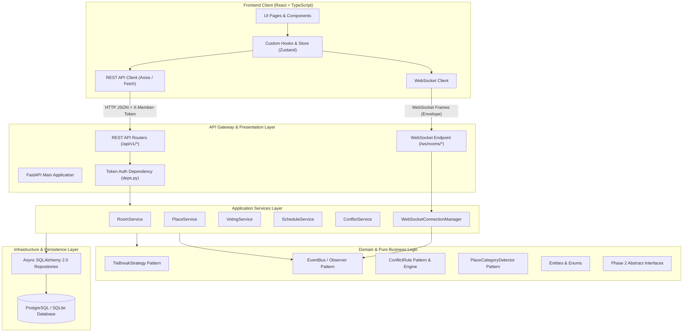
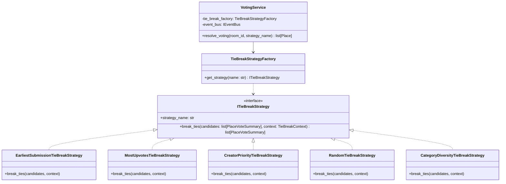
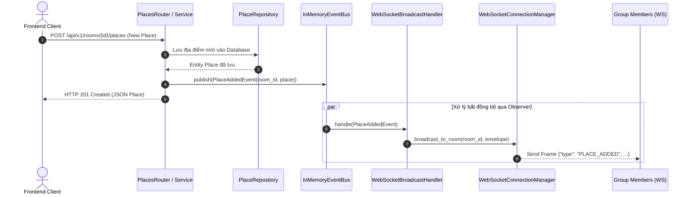
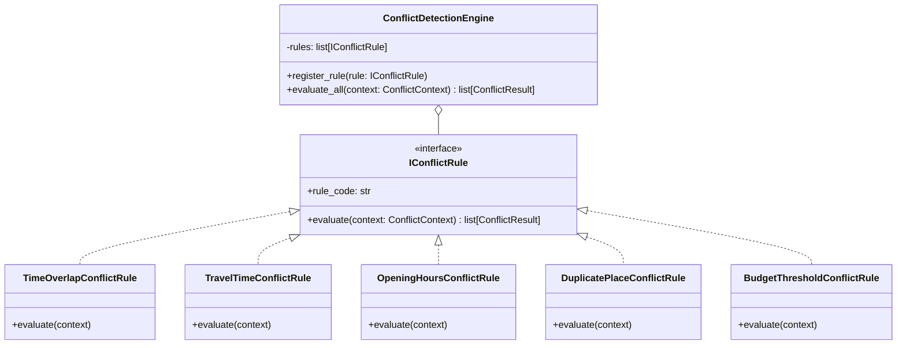
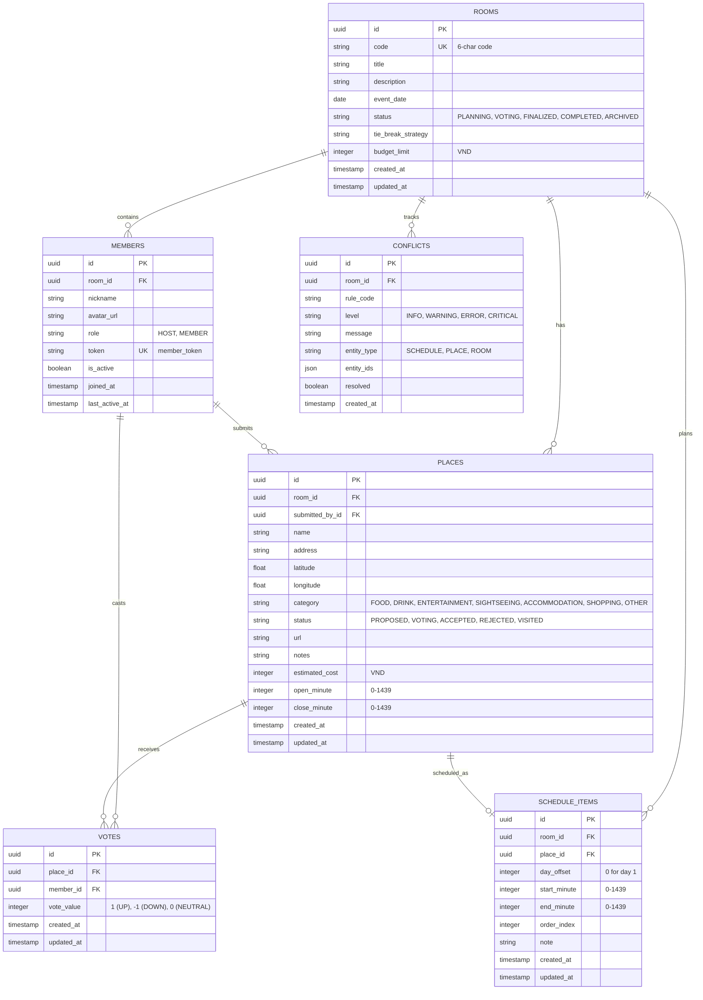

# KIẾN TRÚC HỆ THỐNG ỨNG DỤNG "ĐI ĐÂU" (DI DAU ARCHITECTURE)

Tài liệu này xác lập toàn bộ kiến trúc kỹ thuật của hệ thống ứng dụng "Đi Đâu" (Collaborative Outing Planner), làm cơ sở chuẩn mực để các session AI hoặc kỹ sư độc lập có thể triển khai song song mà không xung đột mã nguồn.

---

## 1. QUYẾT ĐỊNH THIẾT KẾ (DESIGN DECISIONS & ASSUMPTIONS)

1. **Cơ chế xác thực không mật khẩu (Anonymous-First Authentication)**:
   - Người dùng không bắt buộc tạo tài khoản mật khẩu / OAuth để bắt đầu lên kế hoạch cho một buổi đi chơi.
   - Khi tạo phòng hoặc tham gia phòng qua mã phòng (`room_code`), hệ thống sinh ra một `member_token` (chuỗi UUIDv4 ngẫu nhiên bảo mật).
   - `member_token` được client lưu trong `localStorage` và gửi qua HTTP Request Header `X-Member-Token: <token>`. Với kết nối WebSocket, token được truyền qua query parameter: `?token=<token>`.
   - Người tạo phòng tự động nhận role `HOST`. Người tham gia nhận role `MEMBER`.
2. **Quy ước biểu diễn và lưu trữ thời gian (Timezone & Time Format)**:
   - Múi giờ chuẩn: Toàn bộ hệ thống cố định theo múi giờ Việt Nam `Asia/Ho_Chi_Minh` (UTC+7).
   - Lưu trữ giờ trong ngày: Sử dụng số nguyên biểu diễn số phút tính từ 00:00 (`0` đến `1439`).
     * Ví dụ: `09:30` -> $9 \times 60 + 30 = 570$; `14:15` -> $14 \times 60 + 15 = 855$; `23:59` -> $1439$.
     * Lịch trình nhiều ngày sử dụng thuộc tính `day_offset` (số nguyên: `0` cho ngày đầu tiên, `1` cho ngày thứ 2,...).
   - Thời điểm mốc (timestamps: `created_at`, `updated_at`): Lưu trữ định dạng ISO-8601 UTC trong cơ sở dữ liệu (`YYYY-MM-DDTHH:mm:ssZ`), chuyển đổi sang `Asia/Ho_Chi_Minh` khi hiển thị trên UI.
3. **Quy ước định danh (ID & Code Generation)**:
   - Khóa chính nội bộ (Entity IDs): Sử dụng UUIDv4 chuẩn (chuỗi 36 ký tự có dấu gạch ngang, ví dụ: `9b1deb4d-3b7d-4bad-9bdd-2b0d7b3dcb6d`).
   - Mã chia sẻ phòng (`room_code`): Chuỗi 6 ký tự viết hoa gồm chữ cái và số không gây nhầm lẫn (bỏ `0`, `O`, `1`, `I`, ví dụ: `DIDAU8`, `X7K9P2`), được sinh ngẫu nhiên và kiểm tra duy nhất.
4. **Phạm vi phân kỳ (Phase 1 MVP vs Phase 2 Interfaces)**:
   - **Phase 1 (MVP Cốt lõi)**: Tạo phòng, tham gia qua token, đề xuất địa điểm, tự động phân loại danh mục địa điểm (`PlaceCategoryDetector`), bỏ phiếu realtime, phân định hòa phiếu (`TieBreakStrategy`), kiểm tra xung đột thời gian/khoảng cách/ngân sách (`ConflictRule`), xếp lịch trình, đồng bộ WebSocket thông qua `EventBus`.
   - **Phase 2 (Mở rộng nâng cao)**: Tối ưu hóa lộ trình bằng AI/Thuật toán TSP (`IRouteOptimizationService`), tích hợp bên thứ ba Google Places/Map API thực (`IExternalPlacesProvider`), tính toán chia tiền hóa đơn (`IExpenseSplittingService`). Trong giai đoạn này, Phase 2 **chỉ được định nghĩa ở mức Interface/Abstract Class và Stub Mock**, không triển khai logic nghiệp vụ nặng.

---

## 2. CÂY THƯ MỤC CHI TIẾT (FULL DIRECTORY TREE)

```text
.
├── docker-compose.yml
├── Makefile
├── README.md
├── docs/
│   ├── ARCHITECTURE.md
│   ├── CONTRACTS.md
│   ├── TASKS.md
│   └── PROGRESS.md
├── backend/
│   ├── Dockerfile
│   ├── pyproject.toml
│   ├── poetry.lock
│   ├── alembic.ini
│   ├── alembic/
│   │   ├── env.py
│   │   ├── script.py.mako
│   │   └── versions/
│   │       └── 001_initial_schema.py
│   ├── app/
│   │   ├── __init__.py
│   │   ├── main.py
│   │   ├── config.py
│   │   ├── core/
│   │   │   ├── __init__.py
│   │   │   ├── database.py
│   │   │   ├── exceptions.py
│   │   │   ├── security.py
│   │   │   ├── time_utils.py
│   │   │   └── id_generator.py
│   │   ├── domain/
│   │   │   ├── __init__.py
│   │   │   ├── enums.py
│   │   │   ├── models/
│   │   │   │   ├── __init__.py
│   │   │   │   ├── room.py
│   │   │   │   ├── member.py
│   │   │   │   ├── place.py
│   │   │   │   ├── vote.py
│   │   │   │   ├── schedule.py
│   │   │   │   └── conflict.py
│   │   │   ├── patterns/
│   │   │   │   ├── __init__.py
│   │   │   │   ├── tie_break/
│   │   │   │   │   ├── __init__.py
│   │   │   │   │   ├── strategy.py
│   │   │   │   │   └── implementations.py
│   │   │   │   ├── event_bus/
│   │   │   │   │   ├── __init__.py
│   │   │   │   │   ├── events.py
│   │   │   │   │   ├── bus.py
│   │   │   │   │   └── handlers.py
│   │   │   │   ├── conflict_rule/
│   │   │   │   │   ├── __init__.py
│   │   │   │   │   ├── rule.py
│   │   │   │   │   ├── implementations.py
│   │   │   │   │   └── engine.py
│   │   │   │   └── category_detector/
│   │   │   │       ├── __init__.py
│   │   │   │       ├── detector.py
│   │   │   │       └── implementations.py
│   │   │   └── phase2_interfaces/
│   │   │       ├── __init__.py
│   │   │       ├── route_optimization.py
│   │   │       ├── external_places.py
│   │   │       └── expense_splitting.py
│   │   ├── repositories/
│   │   │   ├── __init__.py
│   │   │   ├── base.py
│   │   │   ├── room_repo.py
│   │   │   ├── member_repo.py
│   │   │   ├── place_repo.py
│   │   │   ├── vote_repo.py
│   │   │   ├── schedule_repo.py
│   │   │   └── conflict_repo.py
│   │   ├── services/
│   │   │   ├── __init__.py
│   │   │   ├── room_service.py
│   │   │   ├── member_service.py
│   │   │   ├── place_service.py
│   │   │   ├── voting_service.py
│   │   │   ├── schedule_service.py
│   │   │   ├── conflict_service.py
│   │   │   └── websocket_manager.py
│   │   ├── schemas/
│   │   │   ├── __init__.py
│   │   │   ├── common.py
│   │   │   ├── room.py
│   │   │   ├── member.py
│   │   │   ├── place.py
│   │   │   ├── vote.py
│   │   │   ├── schedule.py
│   │   │   ├── conflict.py
│   │   │   └── websocket.py
│   │   └── api/
│   │       ├── __init__.py
│   │       ├── deps.py
│   │       └── v1/
│   │           ├── __init__.py
│   │           ├── router.py
│   │           ├── rooms.py
│   │           ├── members.py
│   │           ├── places.py
│   │           ├── votes.py
│   │           ├── schedule.py
│   │           ├── conflicts.py
│   │           └── websocket.py
│   └── tests/
│       ├── __init__.py
│       ├── conftest.py
│       ├── unit/
│       │   ├── test_time_utils.py
│       │   ├── test_category_detector.py
│       │   ├── test_tie_break.py
│       │   ├── test_conflict_rules.py
│       │   └── test_event_bus.py
│       ├── integration/
│       │   ├── test_rooms_api.py
│       │   ├── test_places_api.py
│       │   ├── test_votes_api.py
│       │   ├── test_schedule_api.py
│       │   └── test_websocket.py
│       └── mocks/
│           └── phase2_stubs.py
└── frontend/
    ├── Dockerfile
    ├── package.json
    ├── tsconfig.json
    ├── vite.config.ts
    ├── tailwind.config.js
    ├── postcss.config.js
    ├── index.html
    ├── public/
    │   └── favicon.svg
    └── src/
        ├── main.tsx
        ├── App.tsx
        ├── index.css
        ├── types/
        │   ├── enums.ts
        │   ├── models.ts
        │   ├── api.ts
        │   └── websocket.ts
        ├── mocks/
        │   ├── browser.ts
        │   ├── handlers.ts
        │   └── mockData.ts
        ├── services/
        │   ├── api/
        │   │   ├── client.ts
        │   │   ├── roomApi.ts
        │   │   ├── placeApi.ts
        │   │   ├── voteApi.ts
        │   │   ├── scheduleApi.ts
        │   │   └── conflictApi.ts
        │   ├── websocket/
        │   │   ├── wsClient.ts
        │   │   └── wsTypes.ts
        │   └── storage/
        │       └── tokenStorage.ts
        ├── store/
        │   ├── useRoomStore.ts
        │   ├── usePlaceStore.ts
        │   ├── useScheduleStore.ts
        │   └── useConflictStore.ts
        ├── hooks/
        │   ├── useWebSocket.ts
        │   ├── useRoom.ts
        │   └── useMinuteFormat.ts
        ├── components/
        │   ├── common/
        │   │   ├── Button.tsx
        │   │   ├── Input.tsx
        │   │   ├── Modal.tsx
        │   │   ├── Badge.tsx
        │   │   ├── CategoryIcon.tsx
        │   │   ├── ConflictBadge.tsx
        │   │   └── Header.tsx
        │   ├── room/
        │   │   ├── CreateRoomModal.tsx
        │   │   ├── JoinRoomModal.tsx
        │   │   ├── RoomHeader.tsx
        │   │   └── MemberList.tsx
        │   ├── places/
        │   │   ├── PlaceCard.tsx
        │   │   ├── PlaceForm.tsx
        │   │   ├── PlaceList.tsx
        │   │   └── CategoryFilter.tsx
        │   ├── voting/
        │   │   ├── VoteButtons.tsx
        │   │   ├── VoteScoreBadge.tsx
        │   │   └── TieBreakSelectorModal.tsx
        │   ├── schedule/
        │   │   ├── ScheduleTimeline.tsx
        │   │   ├── ScheduleItemCard.tsx
        │   │   ├── AddScheduleItemModal.tsx
        │   │   └── TimeSlotPicker.tsx
        │   └── conflicts/
        │       ├── ConflictAlertBanner.tsx
        │       └── ConflictListModal.tsx
        └── pages/
            ├── HomePage.tsx
            ├── RoomPage.tsx
            └── NotFoundPage.tsx
```

---

## 3. SƠ ĐỒ PHÂN LỚP HỆ THỐNG (LAYERED ARCHITECTURE)

Hệ thống tuân thủ kiến trúc Clean / Onion Architecture tách bạch rõ ràng giữa Presentation, Application Services, Domain Core, và Data Access:



---

## 4. CHI TIẾT DESIGN PATTERNS & VỊ TRÍ TẬP TIN

### 4.1. Pattern 1: `TieBreakStrategy` (Strategy Pattern)
- **Mục đích**: Giải quyết tình huống hòa phiếu khi nhiều địa điểm có cùng tổng điểm vote hoặc số phiếu đồng thuận bằng nhau trong phòng.
- **Tập tin định nghĩa**:
  - Interface: `backend/app/domain/patterns/tie_break/strategy.py`
  - Triển khai cụ thể: `backend/app/domain/patterns/tie_break/implementations.py`
- **Các chiến lược cụ thể**:
  1. `EarliestSubmissionTieBreakStrategy`: Địa điểm nào được đề xuất lên hệ thống trước (`created_at` nhỏ hơn) sẽ được ưu tiên chọn trước.
  2. `MostUpvotesTieBreakStrategy`: Địa điểm nào có số phiếu tán thành tuyệt đối (Upvotes) cao hơn sẽ thắng (ngay cả khi điểm ròng $Upvotes - Downvotes$ bằng nhau).
  3. `CreatorPriorityTieBreakStrategy`: Địa điểm nào do chính Chủ phòng (`HOST`) đề xuất sẽ được ưu tiên thắng.
  4. `RandomTieBreakStrategy`: Chọn ngẫu nhiên có kiểm soát (deterministic pseudo-random dựa trên seed `room_id + place_id`).
  5. `CategoryDiversityTieBreakStrategy`: Ưu tiên địa điểm có danh mục khác biệt với các địa điểm đã được chốt trước đó trong lịch trình.
- **Tương tác**:
  `VotingService` nhận yêu cầu chốt kết quả vote từ Chủ phòng (kèm chiến lược được chỉ định), nạp `ITieBreakStrategy` tương ứng thông qua factory, truyền danh sách địa điểm hòa điểm vào method `break_ties(places)`. Kết quả sau phân định được cập nhật trạng thái `PlaceStatus.ACCEPTED` và phát tán sự kiện qua `EventBus`.



---

### 4.2. Pattern 2: `EventBus / Observer` (Pub-Sub Pattern)
- **Mục đích**: Tách biệt tuyệt đối luồng xử lý nghiệp vụ với cơ chế phát tán thông báo realtime và các tác vụ phụ trợ (đánh giá xung đột ngầm, ghi audit log).
- **Tập tin định nghĩa**:
  - Sự kiện (Events): `backend/app/domain/patterns/event_bus/events.py`
  - Bus interface & InMemory Bus: `backend/app/domain/patterns/event_bus/bus.py`
  - Handlers: `backend/app/domain/patterns/event_bus/handlers.py`
- **Các sự kiện chuẩn**:
  - `MemberJoinedEvent`: Thành viên tham gia phòng.
  - `PlaceAddedEvent`: Đề xuất địa điểm mới.
  - `VoteCastEvent`: Thành viên bỏ/hủy phiếu vote.
  - `PlaceStatusChangedEvent`: Địa điểm đổi trạng thái (chấp nhận/từ chối).
  - `ScheduleUpdatedEvent`: Lịch trình được sắp xếp/kéo thả thay đổi.
  - `ConflictDetectedEvent`: Phát hiện xung đột lịch hoặc thông số.
- **Tương tác**:
  Khi một Service thực hiện xong đột biến dữ liệu (Mutation), Service đó publish một Domain Event vào `IEventBus`. `InMemoryEventBus` điều phối tuần tự hoặc song song (async) tới các Subscriber đã đăng ký:
  1. `WebSocketBroadcastHandler`: Đóng gói payload sự kiện thành chuẩn WebSocket Envelope `{type, payload, ts}` và broadcast tới các kết nối thuộc `room_id`.
  2. `ConflictEvaluationHandler`: Tự động kích hoạt kiểm tra lại toàn bộ luật xung đột khi có sự kiện `ScheduleUpdatedEvent` hoặc `PlaceAddedEvent`.



---

### 4.3. Pattern 3: `ConflictRule` & `ConflictDetectionEngine` (Specification / Rules Engine)
- **Mục đích**: Phát hiện xung đột trong lịch trình và danh sách địa điểm đề xuất mà không phụ thuộc vào cơ sở dữ liệu.
- **Tập tin định nghĩa**:
  - Interface: `backend/app/domain/patterns/conflict_rule/rule.py`
  - Triển khai cụ thể: `backend/app/domain/patterns/conflict_rule/implementations.py`
  - Engine tổng hợp: `backend/app/domain/patterns/conflict_rule/engine.py`
- **Các luật kiểm tra (`IConflictRule`)**:
  1. `TimeOverlapConflictRule`: Kiểm tra xem hai mục trong lịch trình cùng ngày có khoảng thời gian `[start_minute, end_minute]` bị giao nhau không (`CRITICAL`).
  2. `TravelTimeConflictRule`: Kiểm tra thời gian di chuyển giữa 2 địa điểm liên tiếp. Nếu khoảng cách giữa địa điểm A và B đòi hỏi 30 phút nhưng thời gian nghỉ giữa A kết thúc và B bắt đầu chỉ có 5 phút -> cảnh báo (`WARNING`).
  3. `OpeningHoursConflictRule`: Kiểm tra xem giờ xếp lịch `[start_minute, end_minute]` có nằm ngoài khung giờ mở cửa `[open_minute, close_minute]` của địa điểm không (`ERROR`).
  4. `DuplicatePlaceConflictRule`: Kiểm tra xem cùng một địa điểm (trùng tên hoặc tọa độ rất gần < 50m) có bị thêm vào danh sách nhiều lần không (`WARNING`).
  5. `BudgetThresholdConflictRule`: Kiểm tra tổng chi phí ước lượng của các địa điểm được chấp nhận có vượt quá ngân sách của phòng (`budget_limit`) không (`INFO` hoặc `WARNING`).
- **Tương tác**:
  `ConflictDetectionEngine` chứa danh sách các `IConflictRule`. Khi client yêu cầu kiểm tra hoặc khi lịch trình thay đổi, `ConflictService` chuẩn bị `ConflictContext` (danh sách places, schedules, room config) và gọi `engine.evaluate_all(context)`. Danh sách kết quả `list[Conflict]` được trả về client và lưu trữ tạm thời.



---

### 4.4. Pattern 4: `PlaceCategoryDetector` (Strategy / Composite Pipeline)
- **Mục đích**: Tự động nhận diện danh mục địa điểm (`PlaceCategory`: `FOOD`, `DRINK`, `ENTERTAINMENT`, `SIGHTSEEING`, `ACCOMMODATION`, `SHOPPING`, `OTHER`) ngay khi người dùng nhập tên, đường link hoặc tags.
- **Tập tin định nghĩa**:
  - Interface: `backend/app/domain/patterns/category_detector/detector.py`
  - Triển khai cụ thể: `backend/app/domain/patterns/category_detector/implementations.py`
- **Các Detector thành phần**:
  1. `KeywordCategoryDetector`: Quét tên địa điểm theo từ điển tiếng Việt (ví dụ: "Phở", "Bún bò", "Cơm tấm" -> `FOOD`; "Cà phê", "Trà sữa", "The Coffee House", "Highlands" -> `DRINK`; "CGV", "Billiards", "Karaoke" -> `ENTERTAINMENT`).
  2. `UrlPatternCategoryDetector`: Nhận diện dựa trên domain đường link (ví dụ: link ShopeeFood quán ăn -> `FOOD`; link Agoda/Booking -> `ACCOMMODATION`).
  3. `CompositeCategoryDetector`: Lớp bọc tổng hợp (Chain of Responsibility), ưu tiên UrlDetector -> KeywordDetector -> Fallback mặc định (`PlaceCategory.OTHER`).
- **Tương tác**:
  Khi gọi API `POST /api/v1/rooms/{id}/places`, nếu client không gửi category hoặc gửi `OTHER`, `PlaceService` gọi `CompositeCategoryDetector.detect(...)` để gán nhãn tự động trước khi lưu DB.

---

## 5. SƠ ĐỒ THỰC THỂ DỮ LIỆU (ERD - MERMAID)



---

## 6. QUY ƯỚC LẬP TRÌNH VÀ TIÊU CHUẨN KỸ THUẬT

1. **Quy ước đặt tên (Naming Conventions)**:
   - **Database**: Bảng số nhiều, cột snake_case (`rooms`, `created_at`, `submitted_by_id`).
   - **Python**: File/Module `snake_case.py`, Hàm/Biến `snake_case`, Class/Enum `PascalCase`, Hằng số `UPPER_SNAKE_CASE`.
   - **TypeScript**: File/Component `PascalCase.tsx`, Hook `useCamelCase.ts`, Hàm/Biến `camelCase`, Types/Interfaces/Enums `PascalCase`.
   - **REST API Endpoints**: Danh từ số nhiều, chữ thường, gạch nối kebab-case cho các sub-resource nếu có (`/api/v1/rooms/{room_id}/places/{place_id}/votes`).
2. **Quy ước định dạng lỗi API chuẩn (Standard Error Envelope)**:
   - Mọi lỗi HTTP status $\ge 400$ đều phải trả về body JSON thống nhất:
     ```json
     {
       "error": {
         "code": "ROOM_NOT_FOUND",
         "message": "Không tìm thấy phòng với mã yêu cầu.",
         "details": {
           "room_id": "9b1deb4d-3b7d-4bad-9bdd-2b0d7b3dcb6d"
         }
       }
     }
     ```
   - Các mã lỗi cốt lõi:
     - `UNAUTHORIZED`: Thiếu hoặc sai `X-Member-Token`.
     - `FORBIDDEN_HOST_ONLY`: Thao tác chỉ dành cho Chủ phòng (`HOST`).
     - `ROOM_NOT_FOUND`: Phòng không tồn tại.
     - `ROOM_STATUS_INVALID`: Thao tác không được phép ở trạng thái phòng hiện tại.
     - `PLACE_NOT_FOUND`: Địa điểm không tồn tại.
     - `CONFLICT_CRITICAL`: Vi phạm xung đột nghiêm trọng không thể tiếp tục.
     - `VALIDATION_ERROR`: Lỗi dữ liệu đầu vào không hợp lệ.
3. **Quy ước giao thức WebSocket**:
   - Mọi message hai chiều Client $\leftrightarrow$ Server đều bọc trong Envelope chuẩn:
     ```json
     {
       "type": "STRING_UPPER_SNAKE_CASE",
       "payload": {},
       "ts": 1729148400000
     }
     ```
   - `ts` luôn là Unix Epoch timestamp tính bằng mili-giây (UTC).
