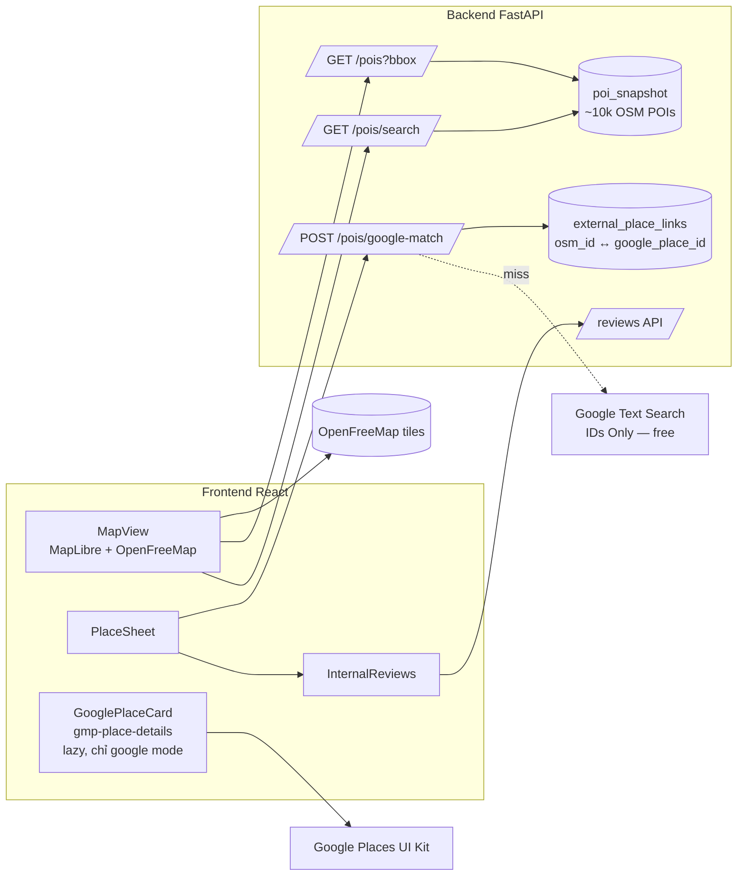

# KẾ HOẠCH GIAI ĐOẠN 2: CHỌN QUÁN TRÊN BẢN ĐỒ, "CHỌN HỘ" VÀ TỰ LÊN LỊCH TRÌNH

> Ngày lập: 2026-10-17 · Trạng thái: **ĐÃ DUYỆT (2026-10-17)** · Tác vụ triển khai: T-23 → T-37 trong [TASKS.md](TASKS.md) · Thay đổi hợp đồng: [CR-02](CHANGE_REQUESTS.md)

Tài liệu này gồm 3 phần: kết quả research nguồn dữ liệu bản đồ/quán (chi phí thật), thiết kế 3 tính năng mới và rủi ro. Mọi con số giá đều lấy từ trang chính thức tại thời điểm lập; nguồn ở mục 9.

---

## 0. TÓM TẮT 1 PHÚT

| Câu hỏi | Kết luận |
| :--- | :--- |
| Chọn quán trên map ngay trong web có tốn phí không? | **Không**, nếu làm đúng cách. Bản đồ dùng **MapLibre + OpenFreeMap** (miễn phí, không cần key). Lớp quán nền dùng **snapshot OpenStreetMap** đóng gói sẵn (miễn phí). |
| Xem sao, review, ảnh thật mà không rời web? | Dùng **Google Places UI Kit**: mỗi tháng miễn phí 10.000 lần mở thẻ quán, vượt mức thì chỉ $1/1.000. Google cho phép dùng UI Kit với bản đồ không phải của Google. Cần một tài khoản billing gắn thẻ, và đặt hạn mức cứng để không bao giờ vượt free tier. |
| Không có thẻ thì sao? | Bật cờ `PLACES_PROVIDER=osm`. App tự lùi về dữ liệu OSM và **review nội bộ** của người dùng app. Vẫn chạy đủ luồng, chỉ thiếu sao/ảnh của Google. |
| Hoà phiếu hoặc phân vân thì sao? | Nút **"🎲 Chọn hộ"** tự hiện ra, gồm 4 chế độ: *Gợi ý 1 chạm* (mặc định), *Vòng quay*, *Swipe*, *Thang may mắn*. Kết quả do server quyết định và broadcast qua WebSocket nên mọi người thấy cùng một kết quả. |
| Tự lên lịch trình? | Host bấm **"✨ Lên lịch giúp tôi"**. Thuật toán sắp xếp quán theo giờ mở cửa, khung giờ bữa ăn và quãng đường, mỗi slot kèm lý do. Host xem trước rồi bấm Áp dụng, sau đó vẫn kéo thả sửa được. Không gọi API trả phí nào. |
| Tổng chi phí ước tính cho đồ án | **0đ/tháng** ở mức demo (vài trăm lượt xem quán mỗi ngày). |

---

## 1. HIỆN TRẠNG CODE (ĐIỂM XUẤT PHÁT)

- `Place` đã có `latitude`, `longitude`, `address`, `url`, `open_minute`, `close_minute`, `estimated_cost`. Chưa có trường liên kết nguồn ngoài (`external_id`, `google_place_id`).
- `backend/app/services/nominatim_service.py` đã có `NominatimService` và `NominatimPlacesProvider`, nhưng **chưa nối vào router nào**. Nominatim chỉ là geocoder (địa chỉ → toạ độ). Nó không tìm quán theo kiểu POI tốt và chính sách OSMF **cấm dùng làm autocomplete** nên không dùng được cho map picker.
- `IRouteOptimizationService.optimize_route()` (`backend/app/domain/phase2_interfaces/route_optimization.py`) mới là stub. Bộ tự lên lịch sẽ hiện thực interface này (mở rộng thêm).
- `TieBreakStrategy` đã có `RANDOM`, nhưng chỉ Host chốt trong modal, không realtime, không "vui".
- `TravelTimeConflictRule` ước lượng di chuyển bằng Haversine với **30 km/h**. Bộ lên lịch **phải dùng cùng bộ ước lượng**, nếu không lịch tự sinh sẽ bị chính conflict engine báo lỗi (xem 5.3).
- Frontend: React 18 + Zustand + Tailwind, chưa có thư viện bản đồ nào.

---

## 2. RESEARCH NGUỒN DỮ LIỆU BẢN ĐỒ & QUÁN

### 2.1. Đo thực tế độ phủ OpenStreetMap (Overpass, 2026-10-17)

| Khu vực | Số quán ăn/uống (restaurant, cafe, fast_food, bar, pub…) | Có tên | Có giờ mở cửa | Có cuisine | Có SĐT |
| :--- | ---: | ---: | ---: | ---: | ---: |
| Lõi Q.1, TP.HCM (~3×3 km) | 1.530 | 75% | 17% | 39% | 14% |
| Lõi Hoàn Kiếm, Hà Nội (~2,4×2,4 km) | 1.325 | 70% | 15% | 27% | 12% |
| **Toàn TP.HCM** | **5.899** | | | | |
| **Toàn Hà Nội** | **4.184** | | | | |

**Diễn giải:** OSM khá dày ở trung tâm, đủ để demo "lướt map chọn quán" ở Q.1, Q.3, Hoàn Kiếm, Ba Đình. Ra ngoại thành thì rất thưa: toàn TP.HCM chỉ ~5.900 điểm, trong khi thực tế có hàng chục nghìn quán. OSM **không có** sao, review, ảnh, và chỉ ~15% quán có giờ mở cửa. Vì vậy OSM chỉ làm được lớp nền, còn nội dung "xem đánh giá" phải lấy từ nguồn khác.

Tổng ~10.000 điểm của 2 thành phố, đóng gói GeoJSON rút gọn chỉ ~2–3 MB. Có thể **snapshot sẵn** vào repo/DB, runtime không cần gọi Overpass. Như vậy demo không phụ thuộc server ngoài, và cũng không vi phạm chính sách dùng Overpass.

### 2.2. So sánh nhà cung cấp

| Phương án | Bản đồ | Tìm quán | Sao / review / ảnh | Free tier | Cần thẻ? | Đánh giá cho đồ án |
| :--- | :--- | :--- | :--- | :--- | :---: | :--- |
| **MapLibre GL + OpenFreeMap** | ✅ vector tiles đẹp | ❌ | ❌ | Không giới hạn, không key | Không | ✅ **Chọn làm bản đồ** |
| **OSM snapshot (Overpass, build 1 lần)** | – | ✅ tên, loại, toạ độ | ❌ (giờ mở ~15%) | Miễn phí (ODbL, ghi nguồn) | Không | ✅ **Chọn làm lớp quán nền** |
| **Google Places UI Kit** (`gmp-place-details`) | – | ✅ (Search/Autocomplete element) | ✅ sao, số review, review, ảnh, giờ, giá, tóm tắt AI | Query: **10.000/tháng**, sau đó $1/1.000. Autocomplete: 10.000 phiên/tháng | **Có** | ✅ **Chọn cho "xem đánh giá"**, sau cờ bật/tắt |
| **Places API (New) Text Search *IDs Only*** | – | ✅ trả `place_id` | – | **Không giới hạn, miễn phí** | Có | ✅ Dùng để nối quán OSM → `place_id` Google |
| Places API (New) Place Details lấy `rating`/`reviews` | – | – | ✅ | `rating` thuộc Enterprise: 1.000/tháng ($20/1.000). `reviews` thuộc Enterprise+Atmosphere: 1.000/tháng ($25/1.000) | Có | ❌ Đắt hơn UI Kit 20–25 lần, lại cấm lưu nội dung |
| Google Maps JS (bản đồ Google) | ✅ | | | 10.000 lượt tải map/tháng, sau đó $7/1.000 | Có | ⚠️ Không cần, MapLibre đã đủ |
| Maps Embed API (iframe) | ✅ | ✅ | ⚠️ chỉ thẻ nhỏ, bấm là sang Google Maps | Không giới hạn | Có (billing) | ⚠️ Thua UI Kit về trải nghiệm "không rời web" |
| Foursquare Places API | – | ✅ | ✅ (Premium) | 10.000 call Pro/tháng; rating/ảnh/tips thuộc Premium ~$18,75/1.000 | Có | ❌ Dữ liệu VN mỏng, field cần dùng lại tính phí |
| Tripadvisor Content API | – | ✅ | ✅ tối đa 5 review + 5 ảnh/quán | 5.000 call/tháng | Có | ⚠️ Chủ yếu quán du lịch, chỉ phủ phần nhỏ quán địa phương, đang chuyển sang API mới |
| Goong.io (VN) | ✅ | ✅ autocomplete tiếng Việt tốt | ❌ | Bảng giá ghi "$0 free credit": Autocomplete $1,4/1.000, Detail $7/1.000 | Có | ❌ Không có review, không free |
| Track-Asia (VN) | ✅ tải tile miễn phí | ✅ $0,58/1.000 | ❌ | Không có free tier tìm kiếm rõ ràng | Có | ❌ |
| Foody / ShopeeFood | – | – | ✅ (review rất sát người Việt) | **Không có API công khai**, scrape vi phạm điều khoản | – | ❌ Loại |
| Nominatim (đã có trong code) | – | ⚠️ geocode địa chỉ | ❌ | 1 req/s, **cấm autocomplete** | Không | ⚠️ Giữ cho "nhập địa chỉ tay" |

### 2.3. Vì sao chọn Google Places UI Kit thay vì gọi Places API lấy rating/review

1. **Giá:** UI Kit tính phí theo *lần khởi tạo element*, không theo field. Element hiển thị đủ sao, review, ảnh, giờ, giá, kèm tóm tắt review bằng AI, giá $1/1.000 sau 10.000 lượt miễn phí. Cùng dữ liệu đó qua Places API là Enterprise + Atmosphere: 1.000 lượt miễn phí, rồi $25/1.000.
2. **Điều khoản:** Places API (thường) cấm hiển thị nội dung Places trên bản đồ không phải Google (Service Specific Terms 3.2.3(e)) và cấm lưu rating/review. Google mô tả UI Kit là cách *"lần đầu tiên dùng nội dung Places trên bản đồ không phải Google"*, với bất kỳ bản đồ nào hoặc không cần bản đồ. App **không đọc và không lưu** rating/review của Google; element tự render. Vì vậy app tuân thủ mà không cần xử lý pháp lý gì thêm.
3. **Nối dữ liệu miễn phí:** Từ quán OSM (tên + toạ độ) → gọi **Text Search IDs Only** (miễn phí, không giới hạn), giới hạn trong ±80 m → nhận `place_id`. Được phép lưu `place_id` vô thời hạn để lần sau khỏi tra lại.
4. **Rủi ro:** Trang tài liệu UI Kit ghi trạng thái *Experimental (pre-GA)*. Vì vậy UI Kit chỉ là một lớp *tăng cường*: lỗi tải hay hết hạn mức thì panel tự lùi về chế độ OSM (xem 7).

### 2.4. Hành vi người dùng Việt (vì sao "đánh giá" phải gói gọn và kết hợp)

- Nghiên cứu trên 362 bạn trẻ 18–25 tuổi ở Hà Nội (Tạp chí Kinh tế – Luật & Ngân hàng, số 286–287, 2026) cho thấy **truyền miệng điện tử trên TikTok** là yếu tố tác động mạnh nhất tới việc chọn quán. Theo đó, kế hoạch có một tuỳ chọn P3: dán link TikTok review vào quán, web nhúng video bằng oEmbed miễn phí, xem ngay trong thẻ quán.
- Review Google cho "độ tin cậy số đông", còn review nội bộ (bạn bè trong app từng đi) cho "độ tin cậy người quen". Phương án **Kết hợp** mà bạn chọn dùng đúng cả hai.

---

## 3. TÍNH NĂNG A: CHỌN QUÁN TRÊN BẢN ĐỒ NGAY TRONG WEB

### 3.1. Luồng người dùng

```text
Tab "🗺️ Bản đồ" trong RoomPage
 ├─ Map mở sẵn tại khu vực của phòng (HCM/HN), chấm quán OSM theo màu category,
 │  gom cụm khi zoom xa. Quán đã có trong phòng có viền đậm + số điểm vote.
 ├─ Ô tìm kiếm: "bún bò", "cafe acoustic"…
 │    • osm mode   → tìm mờ trong snapshot (bỏ dấu tiếng Việt), ưu tiên gần tâm map
 │    • google mode→ Basic Place Autocomplete Element (10.000 phiên miễn phí/tháng)
 ├─ Chạm 1 quán → Bottom sheet (mobile) / panel phải (desktop):
 │    ┌──────────────────────────────────────────┐
 │    │ Tên quán · loại · khoảng cách tới điểm hẹn │
 │    │ [Google: ⭐4.5 (1.2k) · ảnh · giờ · review] │ ← UI Kit, chỉ khi google mode
 │    │ [Bạn bè trong app: ⭐4.0 · "đáng tiền"]    │ ← review nội bộ (luôn có)
 │    │ Giờ mở (OSM nếu có) · cuisine · địa chỉ     │
 │    │ [ + Thêm vào lựa chọn ]  [ 👍 / 👎 nếu đã có ] │
 │    └──────────────────────────────────────────┘
 └─ "+ Thêm vào lựa chọn" → POST place (tự điền tên, toạ độ, địa chỉ, category,
    giờ mở nếu có, external_id) → PLACE_ADDED broadcast → máy bạn bè hiện ngay.
```

- **Chống trùng:** quán có cùng `external_id` đã nằm trong phòng thì nút chuyển thành "Đã trong lựa chọn · vote ngay". `DuplicatePlaceConflictRule` hiện có (<50 m) vẫn là lớp chặn thứ hai.
- **Điểm hẹn:** Host đặt một ghim "điểm tập trung" trên map (trường mới `origin_lat/lng` của phòng). Khoảng cách, gợi ý và lịch trình đều tính từ ghim này.
- **"Gợi ý quanh đây":** khi phòng chưa có quán nào, sheet gợi ý 5 quán OSM gần điểm hẹn, đúng category cần (ví dụ đang thiếu FOOD), chạm là thêm.
- **Giữ form cũ:** `PlaceForm` vẫn còn cho quán không có trên map (thêm tay, dán link).

### 3.2. Kiến trúc



- **Snapshot OSM:** `scripts/build_osm_pois.py` chạy tay khoảng 1 lần/tháng, gọi Overpass cho 2 vùng HCM + HN, rút gọn tag (`name`, `amenity`, `cuisine`, `opening_hours`, `addr:*`, `phone`, `website`) và ghi `backend/app/data/pois_{hcm,hn}.json.gz`. Backend nạp vào bộ nhớ (~10k bản ghi), lọc bbox bằng grid index đơn giản. Lý do không bật PostGIS: dư thừa với 10k điểm, và Render free không cần thêm extension.
- **Chọn nhà cung cấp:** dùng 2 cờ. `PLACES_PROVIDER=osm|google` (backend) và `VITE_GOOGLE_MAPS_BROWSER_KEY` (frontend). Thiếu key thì frontend tự coi là `osm`.
- **Key Google:** cần 2 key.
  - Browser key: giới hạn HTTP referrer là domain Vercel và `localhost`. Chỉ bật *Places UI Kit* và *Maps JavaScript API*.
  - Server key: chỉ bật *Places API (New)*. Backend gọi Text Search với `X-Goog-FieldMask: places.id` để luôn rơi vào SKU IDs Only, tức là miễn phí.
- **Category mapping:** `amenity=restaurant|fast_food|food_court` → FOOD. `cafe|bar|pub|ice_cream` → DRINK. Có thể mở rộng thêm `leisure`/`tourism` → ENTERTAINMENT/SIGHTSEEING ở bước sau.

### 3.3. Chặn chi phí: không bao giờ vượt free tier

| Lớp chặn | Cài đặt |
| :--- | :--- |
| Google Cloud quota (cứng) | Places UI Kit ≤ **300/ngày** (≈ 9.000/tháng < 10.000). Autocomplete ≤ 300 phiên/ngày. Places API (New) Text Search ≤ 1.000/ngày (đằng nào cũng miễn phí, chặn để phòng lạm dụng). |
| Budget alert | Ngưỡng $1, gửi email cả nhóm. |
| Backend | Bộ đếm/ngày trong bộ nhớ cho `/pois/google-match`. Vượt ngưỡng thì trả `{google_place_id: null, reason: "QUOTA"}`, frontend hiển thị chế độ OSM. |
| Frontend | Chỉ khởi tạo `gmp-place-details` khi **người dùng chạm** vào quán, không render trong danh sách hay khi hover. Mỗi lúc chỉ có 1 element. Đóng sheet thì gỡ element. |
| Cache | Bảng `external_place_links` lưu `osm_id → google_place_id`. Lưu `place_id` vô thời hạn là được phép. |

---

## 4. TÍNH NĂNG B: NÚT "🎲 CHỌN HỘ" KHI HOÀ HOẶC PHÂN VÂN

### 4.1. Khi nào nút tự hiện (`DeciderTrigger`, pure logic)

| Mã | Điều kiện | Lý do |
| :--- | :--- | :--- |
| `TIE_AT_TOP` | ≥2 quán cùng category có điểm cao nhất bằng nhau | Đúng tình huống hoà phiếu |
| `NEAR_TIE` | Top-1 và top-2 chênh ≤1 điểm và ≥50% thành viên đã vote | "Khó chọn", không ai thắng rõ |
| `TOO_MANY` | >5 quán PROPOSED cùng category mà mỗi quán có <2 vote | Quá nhiều lựa chọn khiến nhóm đứng hình (choice overload) |
| `STALLED` | Không có vote mới trong 10 phút và chưa có quán ACCEPTED | Nhóm "lười", cần một cú hích |
| `EMPTY` | Phòng chưa có quán nào trong category đang cần | Nút đổi nhãn thành "Gợi ý quán giúp tôi" |

Nút xuất hiện dạng **banner nổi** ngay trên danh sách quán, ví dụ: *"3 quán đang hoà điểm, để app chọn hộ nhé? 🎲"*. Bấm vào là mở **Gợi ý 1 chạm** trước tiên, vì đây là đường nhanh nhất. Các trò khác nằm ở hàng nút phụ.

### 4.2. Bốn chế độ

| Chế độ | Cách chơi | Ai bắt đầu | Kết quả |
| :--- | :--- | :--- | :--- |
| **💡 Gợi ý 1 chạm** (mặc định) | App chấm điểm các ứng viên và đưa ra **1 quán + 2–3 lý do**, ví dụ: "gần điểm hẹn nhất (1,2 km)", "đang mở lúc 18:00", "vừa ngân sách", "nhóm chưa có quán nước". Có 3 nút: **Chốt luôn** / Đổi quán khác / Chơi trò | Ai cũng mở xem được, chỉ Host chốt | Deterministic, giải thích được |
| **🎡 Vòng quay** | Vòng quay realtime, cả phòng cùng xem. Tuỳ chọn "trọng số theo điểm vote" | Host | Server sinh `seed` và kết quả **trước**, broadcast `DECISION_STARTED`. Mọi client quay ~4 s rồi dừng đúng ô kết quả, không ai "quay lại" được |
| **👆 Swipe** | Mỗi người quẹt phải/trái lần lượt các quán ứng viên (≤6), hạn 90 s, có thanh tiến độ "4/5 người xong". Mô hình giống Where2Eat, Food Swiper, Tonight's Bite | Host | Quán được quẹt phải nhiều nhất thắng. Nếu vẫn hoà thì tự quay vòng quay giữa các quán hoà |
| **🪜 Thang may mắn** (사다리타기 bên Hàn / あみだくじ bên Nhật) | Trên đầu thang là các quán, dưới đáy có 1 ô 🏆. Thang sinh từ `seed`, có hoạt ảnh đi đường | Host | Như vòng quay. Có biến thể "chọn **người quyết định**": thang chọn ngẫu nhiên 1 thành viên, người đó chọn quán |

**Vì sao làm nhiều chế độ:** Research qua các nguồn tiếng Hàn, Nhật và Trung cho thấy cùng một mẫu: app "chọn hộ" phổ biến nhất là vòng quay (룰렛 / ルーレット / 大转盘) và thang (사다리타기 / あみだくじ). App ăn khách bên Nhật như "まるっと幹事" gói **bình chọn + lịch trình + chia tiền trong 1 URL, không cần cài app**, cùng triết lý với Đi Đâu. Swipe là mẫu phương Tây cho nhóm. Riêng *Gợi ý 1 chạm* là thứ các app vòng quay đều thiếu: nó dùng chính dữ liệu của phòng (vote, khoảng cách, giờ mở, ngân sách), nên "chọn hộ" có lý do chứ không hoàn toàn may rủi.

### 4.3. Thiết kế kỹ thuật

- **Pure logic** (`backend/app/domain/patterns/decision/`):
  - `DeciderTrigger.evaluate(places, votes, members, now) -> list[TriggerHint]`.
  - `SmartPickScorer.rank(candidates, ctx) -> list[ScoredPick]`, mỗi `ScoredPick` có `reasons: list[str]`. Điểm là tổng có trọng số của: vote chuẩn hoá (0.35), khoảng cách tới điểm hẹn/quán trước (0.25), mở cửa tại giờ dự kiến (0.15), vừa ngân sách (0.10), đa dạng category (0.10), sao review nội bộ (0.05). **Không** dùng rating Google, vì theo điều khoản server không được đọc hay lưu nó.
  - `LadderGenerator.generate(n, seed)` và `WheelPicker.pick(candidates, weights, seed)`, đều deterministic theo seed để test được.
- **Tích hợp tie-break hiện có:** kết quả mọi chế độ đi qua đúng đường `resolve` đã có. Quán thắng chuyển sang `ACCEPTED`, phát `VOTING_RESOLVED`. Thêm `TieBreakStrategyName.GROUP_DECISION` để lịch sử ghi lại "chốt bằng trò chơi".
- **Phiên quyết định:** bảng `decision_sessions` và `decision_swipes` (CR-02). Mỗi phòng chỉ có 1 phiên OPEN. Phiên tự đóng khi hết hạn.
- **Công bằng:** seed sinh bằng `secrets.randbits(63)` ở server và lưu DB. Client chỉ phát hoạt ảnh tới kết quả đã biết. Bấm "xem cách tính" sẽ hiện seed và danh sách ứng viên.

---

## 5. TÍNH NĂNG C: TỰ LÊN LỊCH TRÌNH ("✨ LÊN LỊCH GIÚP TÔI")

### 5.1. Luồng

1. Nút hiện ở tab Lịch trình khi phòng có ≥1 quán `ACCEPTED`, hoặc khi mọi thành viên online đã vote. Nếu đang có `TIE_AT_TOP`, bấm nút sẽ mở **Chọn hộ** trước để xử lý chỗ hoà, rồi mới lên lịch.
2. Ai cũng bấm **Xem trước** được (`POST /schedule/auto-plan`, không ghi DB). Kết quả hiện ra dạng timeline nháp, đường đi vẽ trên map, mỗi slot kèm lý do.
3. **Host** bấm **Áp dụng** (`POST /schedule/auto-plan/apply`). Hệ thống thay lịch hiện tại (có hỏi xác nhận nếu lịch đã có mục), chạy conflict engine, rồi broadcast `SCHEDULE_UPDATED` + `CONFLICTS_UPDATED`.
4. Sau đó vẫn kéo thả như cũ. Có nút "Sắp lại tối ưu" để chạy lại với thứ tự quán hiện có.

### 5.2. Thuật toán (`HeuristicItineraryPlanner`, pure logic, không gọi API ngoài)

- **Đầu vào:** các quán ACCEPTED (nếu không có thì lấy top-score PROPOSED, mỗi category 1 quán), `event_date`, khung giờ phòng (`start_minute`/`end_minute`, mặc định **17:00–23:00**, buổi tối đi chơi; Host đổi được khi tạo/sửa phòng), điểm hẹn, ngân sách.
- **Thời lượng mặc định theo category:** FOOD 75′, DRINK 75′, ENTERTAINMENT 120′, SIGHTSEEING 90′, SHOPPING 60′, OTHER 60′. Người dùng sửa được ở bản xem trước.
- **Neo bữa ăn:** FOOD ưu tiên khung 17:30–20:30 (bữa tối, rơi trong khung mặc định), và 11:00–13:30 nếu Host mở khung giờ phòng bao trùm buổi trưa. DRINK ưu tiên sau FOOD. Với khung 17:00–23:00 (360 phút), một buổi chứa thực tế khoảng 3–4 điểm; quán dư sẽ vào `dropped` kèm lý do "hết giờ trong buổi". Lệch khỏi khung thì bị phạt điểm, không cấm hẳn.
- **Giờ mở cửa:** dùng `open_minute`/`close_minute` có sẵn. Nếu quán đến từ OSM thì parse chuỗi `opening_hours` cho thứ của `event_date` (hỗ trợ các mẫu phổ biến kiểu `Mo-Su 07:00-22:00`, `Mo-Fr …; Sa,Su …`; mẫu lạ thì coi là "không rõ"). Đến sớm thì chờ (bị phạt). Không kịp giờ đóng cửa thì loại quán đó và ghi lý do.
- **Di chuyển:** dùng chung `ITravelTimeEstimator` với `TravelTimeConflictRule`: Haversine × hệ số đường vòng 1,3, chia vận tốc của rule, cộng 10′ gửi xe. Planner luôn *bảo thủ hơn hoặc bằng* rule, nên lịch tự sinh **không bao giờ** bị báo `TRAVEL_TIME`.
- **Tìm kiếm:** n ≤ 7 quán/ngày thì duyệt hết hoán vị (≤5.040), mô phỏng timeline và chọn chi phí thấp nhất. n > 7 thì greedy (gần nhất khả thi) rồi 2-opt. Chi phí = tổng phút di chuyển + 0,5 × phút chờ + 2 × phút lệch khung bữa + 1.000 × quán bị loại. Thời gian chạy <50 ms, deterministic.
- **Quá giờ trong ngày:** tràn sang `day_offset + 1` nếu phòng nhiều ngày. Nếu không, đánh dấu quán "không xếp được" kèm lý do.
- **Đầu ra:** `PlannedSlot{place_id, day_offset, start_minute, end_minute, travel_from_prev_min, reasons[]}` và `dropped[{place_id, reason}]`.
- **Định tuyến thật (tuỳ chọn, P3):** `OpenRouteServiceEstimator` (free 500 matrix/ngày) sau cờ `TRAVEL_ESTIMATOR=haversine|ors`. Mặc định để haversine cho demo ổn định.

### 5.3. Vì sao không dùng Google Routes hoặc AI cho lịch trình

- Compute Route Matrix: 10.000 phần tử/tháng miễn phí, sau đó $5/1.000, và lại cần thẻ. Với ≤7 điểm trong nội thành, Haversine × 1,3 đủ chính xác để xếp thứ tự.
- Thuật toán thuần thì test được, giải thích được ("vì sao 18:00 ăn ở đây") và chạy offline. Nhóm cũng trình bày được trong báo cáo môn học: TSP có time window, brute-force với n nhỏ.

---

## 6. REVIEW NỘI BỘ (PHẦN "KẾT HỢP")

- Bảng `place_reviews` gắn với `external_key` (`osm:node/123`, `google:ChIJ…` hoặc `room_place:<uuid>` cho quán thêm tay), nên review **tích luỹ qua mọi phòng**.
- Mỗi thành viên 1 review/quán: 1–5 sao, tối đa 280 ký tự, và tag nhanh (`ngon`, `đáng tiền`, `chỗ ngồi thoải mái`, `đông`, `phục vụ chậm`). Có thể viết bất cứ lúc nào ("mình từng đi"). Khi phòng sang `COMPLETED` thì nhắc mọi người đánh giá các quán đã đi.
- Hiển thị trong PlaceSheet dưới thẻ Google, hoặc thay thẻ Google khi ở chế độ OSM.
- Dữ liệu này dùng được cho `SmartPickScorer` vì là dữ liệu của chính app.

---

## 7. RỦI RO & PHƯƠNG ÁN DỰ PHÒNG

| Rủi ro | Mức | Giảm thiểu |
| :--- | :---: | :--- |
| UI Kit đang pre-GA, API có thể đổi | TB | Bọc trong `GooglePlaceCard`. Lỗi tải hoặc timeout 4 s thì ẩn thẻ và hiện chế độ OSM. Mọi tính năng khác không phụ thuộc thẻ này. |
| Text Search khớp sai quán (OSM ↔ Google) | TB | `locationRestriction` ±80 m quanh toạ độ OSM, `pageSize=1`. Không xin `displayName` vì làm vậy sẽ nhảy sang SKU Pro tính phí, nên không so tên phía server. Thẻ Google tự hiện tên quán, người dùng thấy sai thì bấm "Không đúng quán?" để xoá liên kết. |
| OpenFreeMap không có SLA | Thấp | Style URL đặt trong config. Phương án B: tự host file PMTiles khu vực VN, hoặc đổi sang style khác chỉ bằng 1 dòng env. |
| Snapshot OSM thiếu quán ngoại thành | Cao (về dữ liệu) | Thêm tay bằng `PlaceForm`. Ở google mode thì Autocomplete tìm được mọi quán. Ghi rõ giới hạn trong báo cáo. |
| Lat/lng lấy từ Google chỉ được cache tối đa 30 ngày | Thấp | Ưu tiên toạ độ OSM. Với quán chỉ có trên Google (thêm qua Autocomplete), lưu `coords_source=GOOGLE` + `coords_fetched_at`, job dọn dẹp sẽ làm tươi hoặc xoá toạ độ sau 30 ngày. |
| Render free bị ngủ (cold start) | Đã có | Snapshot nạp lúc khởi động (~1 s với 10k POI). Màn hình cold-start hiện có giữ nguyên. |
| Lạm dụng key trình duyệt | Thấp | Giới hạn referrer + quota/ngày + budget alert $1. |

---

## 8. LỘ TRÌNH & ƯU TIÊN

| Ưu tiên | Nội dung | Task |
| :---: | :--- | :--- |
| **P0** | Hợp đồng + migration, snapshot OSM, MapView + PlaceSheet + "Thêm vào lựa chọn" (chế độ OSM) | T-23, T-24, T-25, T-27, T-28 |
| **P0** | Planner + nút "Lên lịch giúp tôi" | T-34, T-35, T-36 |
| **P1** | "Chọn hộ": Gợi ý 1 chạm + Vòng quay | T-30, T-31, T-32 |
| **P1** | Google mode (match `place_id` + UI Kit), review nội bộ | T-26, T-29 |
| **P2** | Swipe + Thang may mắn | T-33 |
| **P2** | Tích hợp, seed, E2E, README | T-37 |
| P3 (tuỳ chọn) | Nhúng TikTok review, ORS routing thật, PMTiles tự host | – |

Chi tiết phân rã, file được sửa và tiêu chí hoàn thành nằm ở [TASKS.md mục 3](TASKS.md#3-giai-đoạn-2-bản-đồ-chọn-hộ--tự-lên-lịch-t-23--t-37).

---

## 9. NGUỒN THAM KHẢO

**Giá & điều khoản bản đồ**
- [Google Maps Platform – bảng giá chính thức (SKU, free cap)](https://developers.google.com/maps/billing-and-pricing/pricing)
- [Google Maps Platform pricing overview](https://developers.google.com/maps/billing/overview/)
- [Places API (New) – phân tầng field → SKU](https://developers.google.com/maps/documentation/places/web-service/data-fields)
- [Places UI Kit – tổng quan & cách tính phí](https://developers.google.com/maps/documentation/javascript/places-ui-kit/overview)
- [Place Details Element (full/compact)](https://developers.google.com/maps/documentation/javascript/places-ui-kit/place-details)
- [Getting started with Places UI Kit – "dùng với bất kỳ bản đồ nào"](https://developers.google.com/maps/architecture/places-ui-kit-getting-started)
- [Places API adjustments for EEA – UI Kit miễn trừ "No use with non-Google maps"](https://developers.google.com/maps/comms/eea/places)
- [Google Maps Platform Service Specific Terms (cache lat/lng ≤30 ngày)](https://cloud.google.com/maps-platform/terms/maps-service-terms/index-20240522)
- [Maps Embed API – miễn phí, không giới hạn](https://developers.google.com/maps/documentation/embed/quickstart)
- [Woosmap – Is Google Maps API free in 2026?](https://www.woosmap.com/blog/is-google-maps-api-free)
- [OpenPlacesAPI – What Google Places API actually costs in 2026](https://openplacesapi.com/blog/google-places-api-pricing)
- [Foursquare pricing history (PricingSaaS)](https://pricingsaas.com/companies/foursquare)
- [Tripadvisor Content API FAQ (5.000 call/tháng)](https://tripadvisor-content-api.readme.io/reference/faq)
- [Goong – bảng giá dịch vụ](https://goong.io/?p=203)
- [Track-Asia – bảng giá](https://track-asia.com/en/price-list)
- [OpenFreeMap](https://openfreemap.org)
- [Openrouteservice – gói miễn phí](https://openrouteservice.org/plans/)
- [Nominatim Usage Policy (OSMF)](https://operations.osmfoundation.org/policies/nominatim/)
- [Overpass API (OSM wiki)](https://wiki.openstreetmap.org/wiki/Overpass_API)

**Hành vi & UX "chọn hộ" (VI · EN · KO · JA · ZH)**
- [Ảnh hưởng của TikTok tới lựa chọn địa điểm ăn uống của giới trẻ Hà Nội (HVNH, 2026)](https://hvnh.edu.vn/medias/tapchi/vi/01.2026/system/archivedate/c7747fcc_3009.vi-%20S%E1%BB%91%20286.287-%20Th%C3%A1ng%201.2.2026-%20Nguy%E1%BB%85n%20L%C3%AA%20%C4%90%C3%ACnh%20Qu%C3%BD%20v%C3%A0%20c%E1%BB%99ng%20s%E1%BB%B1-%20%E1%BA%A2nh%20h%C6%B0%E1%BB%9Fng%20c%E1%BB%A7a%20MXH%20Tiktok.pdf)
- [VnEconomy – TikTok đe doạ vị thế tìm kiếm của Google](https://vneconomy.vn/techconnect/dai-gia-tim-kiem-google-nguy-co-bi-tiktok-thay-the.htm)
- [FPT Shop – Top ứng dụng vòng quay cho buổi tụ họp](https://fptshop.com.vn/tin-tuc/giai-tri/vong-quay-sai-khien-167314)
- [Where2Eat – Swipe & Match (Product Hunt)](https://www.producthunt.com/products/where2eat-swipe-match)
- [Chicken Tinder – capstone OSU (swipe chọn quán cho nhóm)](https://blogs.oregonstate.edu/projectchickentinder/?p=1)
- [FairVote – Ranked Choice vs Approval Voting (approval hợp quyết định nhóm thường ngày)](https://fairvote.org/resources/electoral-systems/ranked_choice_voting_vs_approval_voting/)
- [Selunch: 점심 뭐 먹지 (KR)](https://apps.apple.com/py/app/selunch-%EC%A0%90%EC%8B%AC-%EB%AD%90-%EB%A8%B9%EC%A7%80/id6749932778)
- [행운 게임 – 룰렛, 제비뽑기, 사다리타기 (KR)](https://apps.apple.com/kr/app/%ED%96%89%EC%9A%B4-%EA%B2%8C%EC%9E%84-%EB%A3%B0%EB%A0%9B-%EC%A0%9C%EB%B9%84%EB%BD%91%EA%B8%B0-%EC%82%AC%EB%8B%A4%EB%A6%AC%ED%83%80%EA%B8%B0-%EB%B3%91%EB%8F%8C%EB%A6%AC%EA%B8%B0/id1005392069)
- [まるっと幹事 – 投票・行程・割り勘を1つのURLに (JP)](https://aipicks.jp/showcase/marutto-kanji)
- [飲み会アプリ ランキング (JP)](https://www.appbank.net/app-rank/life/nomikai-app)
- [小决定 – 大转盘 (CN)](https://apps.apple.com/cm/app/%E5%B0%8F%E5%86%B3%E5%AE%9A-%E5%A4%A7%E8%BD%AC%E7%9B%98%E9%9A%8F%E6%9C%BA%E9%80%89%E6%8B%A9%E8%BD%AF%E4%BB%B6/id6484501845?l=en-GB)
- [ifanr – 小程序 抽签抓阄 (CN)](https://www.ifanr.com/minapp/1133127)
- [Wanderlog – route optimizer & auto-fill day](https://apps.apple.com/us/app/wanderlog/id1476732439)
