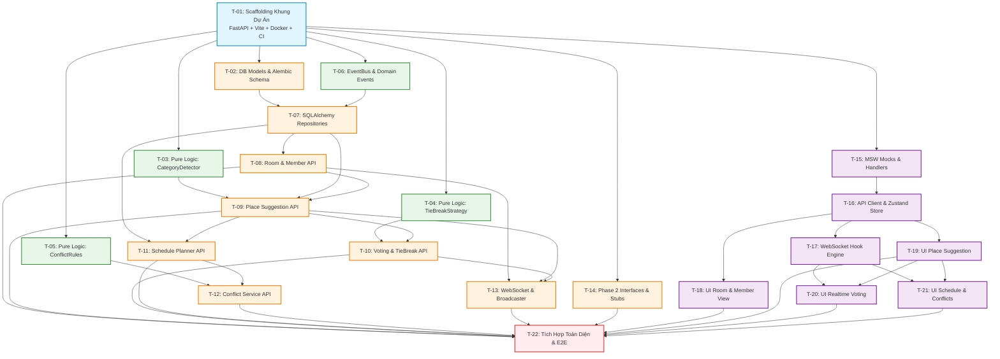

# DANH SÁCH TÁC VỤ PHÂN CHIA (TASKS BREAKDOWN)

Tài liệu này chia nhỏ toàn bộ dự án "Đi Đâu" thành 22 tác vụ độc lập (T-01 đến T-22). Mỗi tác vụ được thiết kế tối ưu vừa sức cho một session AI (dưới 15 files và dưới 1500 dòng code), có ranh giới file rõ ràng và tiêu chí kiểm thử tự động / thủ công cụ thể.

---

## 1. ĐỒ THỊ PHỤ THUỘC VÀ CÁC LÀN CHẠY SONG SONG (DEPENDENCY GRAPH)

---

## 2. CHI TIẾT TỪNG TÁC VỤ

### T-01: Scaffolding Khung Dự Án (FastAPI, Vite, Docker Compose, CI)
- **Phụ thuộc**: Không
- **Có thể chạy song song với**: Không
- **Được phép tạo/sửa**:
  - `docker-compose.yml`, `Makefile`, `.gitignore`
  - `backend/Dockerfile`, `backend/pyproject.toml`, `backend/app/main.py`, `backend/app/config.py`
  - `frontend/Dockerfile`, `frontend/package.json`, `frontend/vite.config.ts`, `frontend/tsconfig.json`, `frontend/tailwind.config.js`, `frontend/postcss.config.js`, `frontend/index.html`, `frontend/src/App.tsx`, `frontend/src/main.tsx`
  - `.github/workflows/ci.yml` (nếu có)
- **KHÔNG được sửa**: Thư mục `docs/`
- **Mô tả**: Khởi tạo cấu trúc dự án chuẩn, thiết lập môi trường Python Poetry/Pip cho backend và Vite + React + Tailwind + TypeScript cho frontend. Thiết lập `docker-compose.yml` chạy đồng thời backend (cổng 8000), frontend (cổng 5173), và database (PostgreSQL 15 cổng 5432). Viết cấu hình linter (flake8/black/ruff hoặc ruff + pyright, eslint + prettier).
- **Tiêu chí hoàn thành**:
  - Lệnh `docker-compose up --build` khởi động cả 3 container không có lỗi.
  - Endpoint `GET http://localhost:8000/health` trả về `{"status": "ok"}`.
  - Trang web `http://localhost:5173` hiển thị tiêu đề "Đi Đâu".
  - Chạy `pytest` ở backend pass test rỗng ban đầu; `npm run build` ở frontend pass không lỗi type.
- **Cách kiểm tra thủ công**: Chạy `curl http://localhost:8000/health` và mở trình duyệt truy cập `http://localhost:5173`.

---

### T-02: Backend Core Models, Database Connection & Alembic Migrations
- **Phụ thuộc**: T-01
- **Có thể chạy song song với**: T-03, T-04, T-05, T-06, T-15
- **Được phép tạo/sửa**:
  - `backend/app/core/database.py`, `backend/app/core/exceptions.py`, `backend/app/core/time_utils.py`, `backend/app/core/id_generator.py`
  - `backend/app/domain/enums.py`
  - `backend/app/domain/models/room.py`, `backend/app/domain/models/member.py`, `backend/app/domain/models/place.py`, `backend/app/domain/models/vote.py`, `backend/app/domain/models/schedule.py`, `backend/app/domain/models/conflict.py`
  - `backend/alembic.ini`, `backend/alembic/*`
  - `backend/tests/unit/test_time_utils.py`
- **KHÔNG được sửa**: Frontend, logic patterns (`backend/app/domain/patterns/*`), API Routers.
- **Mô tả**: Định nghĩa đầy đủ các SQLAlchemy 2.0 Async declarative models và Alembic migration tương ứng chính xác với Schema DB trong `CONTRACTS.md`. Viết tiện ích chuyển đổi giờ phút `time_utils.py` (chuyển đổi giữa định dạng `HH:MM` và phút từ 0:00, timezone `Asia/Ho_Chi_Minh`).
- **Tiêu chí hoàn thành**:
  - Chạy `alembic upgrade head` tạo thành công tất cả 6 bảng trong PostgreSQL/SQLite.
  - `pytest tests/unit/test_time_utils.py` pass 100% test cases (chuyển đổi giờ `00:00` -> 0, `09:30` -> 570, `23:59` -> 1439 và ngược lại).
- **Cách kiểm tra thủ công**: Kết nối database kiểm tra bảng và cột bằng `\dt` hoặc SQLite inspector.

---

### T-03: Pure Logic - PlaceCategoryDetector Pattern & Unit Tests
- **Phụ thuộc**: T-01
- **Có thể chạy song song với**: T-02, T-04, T-05, T-06, T-15
- **Được phép tạo/sửa**:
  - `backend/app/domain/patterns/category_detector/*`
  - `backend/tests/unit/test_category_detector.py`
- **KHÔNG được sửa**: Database models, Repositories, Routers.
- **Mô tả**: Hiện thực hóa interface `IPlaceCategoryDetector` và các lớp cụ thể:
  1. `KeywordCategoryDetector`: Nhận diện danh mục bằng bộ từ khóa tiếng Việt (phở, bún, bánh canh -> FOOD; cafe, trà sữa, pub -> DRINK; cgv, rạp chiếu, bida -> ENTERTAINMENT;...).
  2. `UrlPatternCategoryDetector`: Nhận diện qua domain (shopeefood.vn, grab.com/food -> FOOD; agoda.com, booking.com -> ACCOMMODATION).
  3. `CompositeCategoryDetector`: Kết hợp các detector với thứ tự ưu tiên và fallback về `PlaceCategory.OTHER`.
- **Tiêu chí hoàn thành**:
  - `pytest tests/unit/test_category_detector.py` pass với ít nhất 20 test cases kiểm thử các tên quán phổ biến tại Việt Nam. Không phụ thuộc DB.
- **Cách kiểm tra thủ công**: Chạy `python -m pytest tests/unit/test_category_detector.py -v`.

---

### T-04: Pure Logic - TieBreakStrategy Pattern & Voting Resolution
- **Phụ thuộc**: T-01
- **Có thể chạy song song với**: T-02, T-03, T-05, T-06, T-15
- **Được phép tạo/sửa**:
  - `backend/app/domain/patterns/tie_break/*`
  - `backend/tests/unit/test_tie_break.py`
- **KHÔNG được sửa**: Database models, Routers, Repositories.
- **Mô tả**: Hiện thực hóa interface `ITieBreakStrategy` và 5 chiến lược phân định hòa phiếu:
  1. `EarliestSubmissionTieBreakStrategy`: Ưu tiên địa điểm có `created_at` sớm nhất.
  2. `MostUpvotesTieBreakStrategy`: Ưu tiên địa điểm có số lượt Upvote tuyệt đối nhiều hơn.
  3. `CreatorPriorityTieBreakStrategy`: Ưu tiên địa điểm do Host đề xuất.
  4. `RandomTieBreakStrategy`: Phân định ngẫu nhiên có kiểm soát (deterministic pseudo-random qua seed).
  5. `CategoryDiversityTieBreakStrategy`: Ưu tiên địa điểm có Category chưa xuất hiện trong các địa điểm đã chấp nhận.
  - Viết `TieBreakStrategyFactory` nạp chiến lược theo tên.
- **Tiêu chí hoàn thành**:
  - `pytest tests/unit/test_tie_break.py` pass 100% các kịch bản hòa phiếu mô phỏng.
- **Cách kiểm tra thủ công**: Chạy `python -m pytest tests/unit/test_tie_break.py -v`.

---

### T-05: Pure Logic - ConflictRule Pattern & ConflictDetectionEngine
- **Phụ thuộc**: T-01
- **Có thể chạy song song với**: T-02, T-03, T-04, T-06, T-15
- **Được phép tạo/sửa**:
  - `backend/app/domain/patterns/conflict_rule/*`
  - `backend/tests/unit/test_conflict_rules.py`
- **KHÔNG được sửa**: Database models, Routers, Repositories.
- **Mô tả**: Hiện thực hóa interface `IConflictRule` và `ConflictDetectionEngine`:
  1. `TimeOverlapConflictRule`: Báo `CRITICAL` nếu 2 mục lịch trình cùng ngày có khung giờ `[start_minute, end_minute]` giao nhau.
  2. `TravelTimeConflictRule`: Báo `WARNING` nếu khoảng thời gian giữa 2 địa điểm liên tiếp bé hơn thời gian di chuyển ước tính dựa trên khoảng cách tọa độ Haversine.
  3. `OpeningHoursConflictRule`: Báo `ERROR` nếu xếp lịch ngoài khung giờ mở cửa `[open_minute, close_minute]`.
  4. `DuplicatePlaceConflictRule`: Báo `WARNING` nếu 2 địa điểm có tên giống nhau (>90% tương đồng) hoặc khoảng cách tọa độ < 50 mét.
  5. `BudgetThresholdConflictRule`: Báo `WARNING` nếu tổng chi phí vượt ngân sách `budget_limit`.
- **Tiêu chí hoàn thành**:
  - `pytest tests/unit/test_conflict_rules.py` pass tất cả kịch bản kiểm tra xung đột logic thuần không cần kết nối DB.
- **Cách kiểm tra thủ công**: Chạy `python -m pytest tests/unit/test_conflict_rules.py -v`.

---

### T-06: EventBus & Domain Event System
- **Phụ thuộc**: T-01
- **Có thể chạy song song với**: T-02, T-03, T-04, T-05, T-15
- **Được phép tạo/sửa**:
  - `backend/app/domain/patterns/event_bus/*`
  - `backend/tests/unit/test_event_bus.py`
- **KHÔNG được sửa**: Database models, Routers.
- **Mô tả**: Xây dựng hệ thống Domain Event và `InMemoryEventBus` cho phép đăng ký subscriber và xuất bản sự kiện bất đồng bộ (`async def publish(event)`). Định nghĩa các sự kiện: `MemberJoinedEvent`, `PlaceAddedEvent`, `VoteCastEvent`, `PlaceStatusChangedEvent`, `ScheduleUpdatedEvent`, `ConflictDetectedEvent`.
- **Tiêu chí hoàn thành**:
  - `pytest tests/unit/test_event_bus.py` pass: khi publish sự kiện, tất cả các handler đã đăng ký đều được kích hoạt với payload chính xác.
- **Cách kiểm tra thủ công**: Chạy `python -m pytest tests/unit/test_event_bus.py -v`.

---

### T-07: Backend Database Repositories Layer (SQLAlchemy Async)
- **Phụ thuộc**: T-02, T-06
- **Có thể chạy song song với**: T-03, T-04, T-05, T-15
- **Được phép tạo/sửa**:
  - `backend/app/repositories/*`
  - `backend/tests/integration/test_repositories.py`
- **KHÔNG được sửa**: Domain patterns, API Routers, Frontend.
- **Mô tả**: Hiện thực hóa các interface repository đã định nghĩa trong `CONTRACTS.md` bằng SQLAlchemy 2.0 Async Session:
  - `RoomRepository`, `MemberRepository`, `PlaceRepository`, `VoteRepository`, `ScheduleRepository`, `ConflictRepository`.
  - Hỗ trợ đầy đủ các truy vấn: tìm theo ID, mã phòng `code`, token thành viên `token`, upsert phiếu vote, tính toán tổng điểm vote bằng SQL aggregation.
- **Tiêu chí hoàn thành**:
  - `pytest tests/integration/test_repositories.py` pass với database SQLite Async / Test PostgreSQL: CRUD hoạt động trơn tru, quan hệ khóa ngoại và xóa cascade đúng quy cách.
- **Cách kiểm tra thủ công**: Chạy test integration của repositories.

---

### T-08: Backend Room & Member Service & REST API Routers
- **Phụ thuộc**: T-07
- **Có thể chạy song song với**: T-09, T-10, T-11, T-12, T-15
- **Được phép tạo/sửa**:
  - `backend/app/schemas/common.py`, `backend/app/schemas/room.py`, `backend/app/schemas/member.py`
  - `backend/app/services/room_service.py`, `backend/app/services/member_service.py`
  - `backend/app/api/deps.py`, `backend/app/api/v1/rooms.py`, `backend/app/api/v1/members.py`, `backend/app/api/v1/router.py`
  - `backend/tests/integration/test_rooms_api.py`
- **KHÔNG được sửa**: Place logic, Schedule logic, Frontend.
- **Mô tả**:
  - Xây dựng dependency xác thực `get_current_member` trong `deps.py` kiểm tra `X-Member-Token`.
  - Endpoint `POST /api/v1/rooms`: Tạo phòng mới, sinh mã phòng 6 ký tự ngẫu nhiên, tạo host member và trả về `member_token`.
  - Endpoint `POST /api/v1/rooms/join`: Tham gia phòng bằng mã phòng và nickname, trả về `member_token`.
  - Endpoint `GET /api/v1/rooms/{room_id}`: Lấy thông tin phòng và danh sách thành viên.
  - Phát sự kiện `MemberJoinedEvent` qua `EventBus` khi có người tham gia.
- **Tiêu chí hoàn thành**:
  - `pytest tests/integration/test_rooms_api.py` pass: Tạo phòng, join phòng, kiểm tra mã phòng trùng lặp, nickname trùng lặp, token auth thất bại trả về lỗi chuẩn `ApiErrorEnvelope`.
- **Cách kiểm tra thủ công**: Dùng cURL gọi tạo phòng và join phòng.

---

### T-09: Backend Place Application Service & REST API Endpoints
- **Phụ thuộc**: T-03, T-07, T-08
- **Có thể chạy song song với**: T-10, T-11, T-12, T-15
- **Được phép tạo/sửa**:
  - `backend/app/schemas/place.py`
  - `backend/app/services/place_service.py`
  - `backend/app/api/v1/places.py`
  - `backend/tests/integration/test_places_api.py`
- **KHÔNG được sửa**: Voting logic, Schedule logic.
- **Mô tả**:
  - Tích hợp `PlaceCategoryDetector` vào `PlaceService`: tự động gán nhãn danh mục khi người dùng thêm địa điểm mới.
  - Endpoint `POST /api/v1/rooms/{room_id}/places`: Thêm địa điểm mới đề xuất, phát sự kiện `PlaceAddedEvent`.
  - Endpoint `GET /api/v1/rooms/{room_id}/places`: Lấy danh sách địa điểm của phòng kèm tóm tắt điểm vote và vote của thành viên hiện tại.
  - Endpoint `PATCH /api/v1/rooms/{room_id}/places/{place_id}` và `DELETE /api/v1/rooms/{room_id}/places/{place_id}` (kiểm tra quyền submitter hoặc host).
- **Tiêu chí hoàn thành**:
  - `pytest tests/integration/test_places_api.py` pass: Thêm địa điểm tự động nhận diện danh mục đúng; lấy danh sách thành công.
- **Cách kiểm tra thủ công**: Gửi cURL thêm quán "Cà Phê Trứng 3T" và kiểm tra xem danh mục có tự chuyển thành `DRINK` hay không.

---

### T-10: Backend Voting Application Service & TieBreak REST API Endpoints
- **Phụ thuộc**: T-04, T-09
- **Có thể chạy song song với**: T-11, T-12, T-15
- **Được phép tạo/sửa**:
  - `backend/app/schemas/vote.py`
  - `backend/app/services/voting_service.py`
  - `backend/app/api/v1/votes.py`
  - `backend/tests/integration/test_votes_api.py`
- **KHÔNG được sửa**: Schedule logic, Conflict logic.
- **Mô tả**:
  - Endpoint `POST /api/v1/rooms/{room_id}/places/{place_id}/votes`: Bỏ phiếu `+1`, `-1`, hoặc `0`. Cập nhật điểm và phát sự kiện `VoteCastEvent`.
  - Endpoint `DELETE /api/v1/rooms/{room_id}/places/{place_id}/votes`: Rút phiếu vote.
  - Endpoint `POST /api/v1/rooms/{room_id}/voting/resolve`: Dành riêng cho `HOST`. Áp dụng `TieBreakStrategy` để chốt top $N$ địa điểm thành `ACCEPTED`, số còn lại thành `REJECTED`, phát sự kiện `PlaceStatusChangedEvent`.
- **Tiêu chí hoàn thành**:
  - `pytest tests/integration/test_votes_api.py` pass: Vote hợp lệ, đổi vote, tính toán điểm số chính xác, chốt kết quả bằng TieBreak chính xác.
- **Cách kiểm tra thủ công**: Tạo 2 user vote hòa điểm cho 2 quán, gọi API resolve với `MOST_UPVOTES` và kiểm tra quán thắng cuộc.

---

### T-11: Backend Schedule Application Service & REST API Endpoints
- **Phụ thuộc**: T-07, T-09
- **Có thể chạy song song với**: T-10, T-12, T-15
- **Được phép tạo/sửa**:
  - `backend/app/schemas/schedule.py`
  - `backend/app/services/schedule_service.py`
  - `backend/app/api/v1/schedule.py`
  - `backend/tests/integration/test_schedule_api.py`
- **KHÔNG được sửa**: Voting logic, WebSocket manager.
- **Mô tả**:
  - Endpoint `GET /api/v1/rooms/{room_id}/schedule`: Lấy danh sách lịch trình theo thứ tự thời gian.
  - Endpoint `POST /api/v1/rooms/{room_id}/schedule`: Thêm một địa điểm vào khung giờ cụ thể (`day_offset`, `start_minute`, `end_minute`).
  - Endpoint `PUT /api/v1/rooms/{room_id}/schedule`: Bulk update (sắp xếp lại thứ tự / đổi giờ kéo thả). Phát sự kiện `ScheduleUpdatedEvent`.
  - Endpoint `DELETE /api/v1/rooms/{room_id}/schedule/{item_id}`: Xóa mục lịch trình.
- **Tiêu chí hoàn thành**:
  - `pytest tests/integration/test_schedule_api.py` pass: Thêm, sửa, sắp xếp lịch trình thành công; kiểm tra ràng buộc `start_minute < end_minute`.
- **Cách kiểm tra thủ công**: Gửi request tạo 2 mục lịch trình và gọi bulk update thay đổi thứ tự.

---

### T-12: Backend Conflict Service & Evaluation REST API Endpoints
- **Phụ thuộc**: T-05, T-11
- **Có thể chạy song song với**: T-10, T-13, T-14, T-15
- **Được phép tạo/sửa**:
  - `backend/app/schemas/conflict.py`
  - `backend/app/services/conflict_service.py`
  - `backend/app/api/v1/conflicts.py`
  - `backend/tests/integration/test_conflicts_api.py`
- **KHÔNG được sửa**: WebSocket manager, Frontend.
- **Mô tả**:
  - Nối `ConflictDetectionEngine` với cơ sở dữ liệu qua `ConflictService`.
  - Tự động đăng ký `ConflictEvaluationHandler` lắng nghe `ScheduleUpdatedEvent` và `PlaceAddedEvent` trên `EventBus` để đánh giá lại xung đột ngầm.
  - Endpoint `GET /api/v1/rooms/{room_id}/conflicts`: Lấy danh sách cảnh báo xung đột hiện tại của phòng.
  - Endpoint `POST /api/v1/rooms/{room_id}/conflicts/evaluate`: Kích hoạt đánh giá thủ công và trả về danh sách xung đột mới nhất.
- **Tiêu chí hoàn thành**:
  - `pytest tests/integration/test_conflicts_api.py` pass: Khi xếp lịch 2 quán đè giờ nhau (09:00-10:00 và 09:30-10:30), API trả về xung đột `TIME_OVERLAP` mức `CRITICAL`.
- **Cách kiểm tra thủ công**: Thử tạo lịch trùng giờ và gọi API evaluate xem kết quả JSON.

---

### T-13: Backend WebSocket Connection Manager & Realtime Broadcaster
- **Phụ thuộc**: T-08, T-09, T-10, T-11
- **Có thể chạy song song với**: T-12, T-14, T-15
- **Được phép tạo/sửa**:
  - `backend/app/schemas/websocket.py`
  - `backend/app/services/websocket_manager.py`
  - `backend/app/domain/patterns/event_bus/handlers.py`
  - `backend/app/api/v1/websocket.py`
  - `backend/tests/integration/test_websocket.py`
- **KHÔNG được sửa**: Repositories, Domain patterns thuần.
- **Mô tả**:
  - Hiện thực `WebSocketConnectionManager` quản lý kết nối socket theo từng `room_id`.
  - Endpoint `WebSocket /ws/rooms/{room_id}?token={member_token}`: Xác thực token thành viên khi kết nối.
  - Đăng ký `WebSocketBroadcastHandler` vào `EventBus`: Bất cứ khi nào có Domain Event (`MemberJoinedEvent`, `PlaceAddedEvent`, `VoteCastEvent`, `ScheduleUpdatedEvent`,...), handler tự đóng gói phong bì `{type, payload, ts}` và broadcast tới các client đang kết nối trong phòng.
  - Hỗ trợ sự kiện heartbeat `PING` / `PONG`.
- **Tiêu chí hoàn thành**:
  - `pytest tests/integration/test_websocket.py` pass: Kết nối websocket thành công; khi gọi REST API thêm địa điểm thì kết nối websocket nhận được message `PLACE_ADDED`.
- **Cách kiểm tra thủ công**: Mở kết nối qua `wscat` hoặc Python test script để lắng nghe sự kiện khi gọi REST API.

---

### T-14: Backend Phase 2 Abstract Interfaces & Stub Implementations
- **Phụ thuộc**: T-01
- **Có thể chạy song song với**: Tất cả các task khác
- **Được phép tạo/sửa**:
  - `backend/app/domain/phase2_interfaces/*`
  - `backend/tests/mocks/phase2_stubs.py`
  - `backend/tests/unit/test_phase2_stubs.py`
- **KHÔNG được sửa**: Core Phase 1 APIs.
- **Mô tả**: Định nghĩa chuẩn xác các Abstract Base Class (`ABC`) cho Phase 2 theo `CONTRACTS.md`:
  - `IRouteOptimizationService`: Tối ưu hóa lộ trình di chuyển.
  - `IExternalPlacesProvider`: Tích hợp tìm kiếm địa điểm từ bản đồ bên ngoài.
  - `IExpenseSplittingService`: Tính toán chia hóa đơn theo nhóm.
  - Cung cấp các lớp Mock / Stub đơn giản trả về dữ liệu mẫu để đảm bảo tuân thủ nguyên tắc Dependency Inversion.
- **Tiêu chí hoàn thành**:
  - `pytest tests/unit/test_phase2_stubs.py` pass: Kiểm tra kiểu dữ liệu và chữ ký phương thức khớp 100% với đặc tả hợp đồng.
- **Cách kiểm tra thủ công**: Chạy test kiểm thử stub interfaces.

---

### T-15: Frontend Mock Service Worker (MSW) & Contract Mock Handlers
- **Phụ thuộc**: T-01
- **Có thể chạy song song với**: T-02, T-03, T-04, T-05, T-06, T-07, T-08
- **Được phép tạo/sửa**:
  - `frontend/src/types/*`
  - `frontend/src/mocks/browser.ts`, `frontend/src/mocks/handlers.ts`, `frontend/src/mocks/mockData.ts`
  - `frontend/src/main.tsx` (bật cờ `ENABLE_MSW`)
- **KHÔNG được sửa**: Backend code.
- **Mô tả**:
  - Định nghĩa toàn bộ TypeScript types trong `frontend/src/types/` khớp 1-1 với schema trong `CONTRACTS.md`.
  - Cài đặt và cấu hình Mock Service Worker (MSW) chặn toàn bộ request `/api/v1/*` và trả về mock data chân thực theo đúng hợp đồng `CONTRACTS.md`.
  - Cho phép đội ngũ Frontend phát triển và kiểm thử giao diện hoàn chỉnh độc lập mà không cần backend đang chạy.
- **Tiêu chí hoàn thành**:
  - Khởi động Vite với `VITE_ENABLE_MOCK=true`, mở Console trình duyệt thấy `[MSW] Mocking enabled`.
  - Gọi `fetch('/api/v1/rooms/c1f7a0b3-6c8a-4d45-9e28-86d48e89ef21')` trả về JSON phòng mẫu.
- **Cách kiểm tra thủ công**: Chạy `npm run dev` trên frontend và xem log network trong DevTools.

---

### T-16: Frontend API Client, Token Storage & Global Zustand Stores
- **Phụ thuộc**: T-15
- **Có thể chạy song song với**: T-17, T-18
- **Được phép tạo/sửa**:
  - `frontend/src/services/storage/tokenStorage.ts`
  - `frontend/src/services/api/*`
  - `frontend/src/store/*`
- **KHÔNG được sửa**: Backend code, Mock handlers.
- **Mô tả**:
  - Xây dựng module `tokenStorage.ts` lưu/đọc/xóa `member_token` trong `localStorage`.
  - Xây dựng HTTP Client (`client.ts` dùng Axios hoặc Fetch) tự động gắn header `X-Member-Token: <token>`.
  - Viết các API services: `roomApi.ts`, `placeApi.ts`, `voteApi.ts`, `scheduleApi.ts`, `conflictApi.ts`.
  - Xây dựng các Zustand stores: `useRoomStore`, `usePlaceStore`, `useScheduleStore`, `useConflictStore`.
- **Tiêu chí hoàn thành**:
  - Các store gọi API qua MSW và cập nhật state chuẩn xác.
- **Cách kiểm tra thủ công**: Viết unit test nhanh với Vitest hoặc kiểm tra store trên React DevTools.

---

### T-17: Frontend WebSocket Client & Realtime Hook Engine
- **Phụ thuộc**: T-16
- **Có thể chạy song song với**: T-18, T-19
- **Được phép tạo/sửa**:
  - `frontend/src/services/websocket/wsClient.ts`, `frontend/src/services/websocket/wsTypes.ts`
  - `frontend/src/hooks/useWebSocket.ts`, `frontend/src/hooks/useRoom.ts`
- **KHÔNG được sửa**: Backend code.
- **Mô tả**:
  - Xây dựng client WebSocket tự động kết nối lại (auto-reconnect với exponential backoff), gửi nhịp tim `PING` mỗi 30 giây, đóng gói/giải mã envelope `{type, payload, ts}`.
  - Xây dựng custom hook `useWebSocket(roomId)` tự động phân phối các sự kiện (`PLACE_ADDED`, `VOTE_UPDATED`, `SCHEDULE_UPDATED`, `CONFLICTS_UPDATED`) cập nhật thẳng vào các Zustand store tương ứng.
- **Tiêu chí hoàn thành**:
  - Hook quản lý vòng đời kết nối an toàn, không bị duplicate event listener khi re-render.
- **Cách kiểm tra thủ công**: Thử dispatch message giả lập vào client và kiểm tra Zustand store tự cập nhật.

---

### T-18: Frontend UI - Room Creation, Joining & Member List View
- **Phụ thuộc**: T-16
- **Có thể chạy song song với**: T-17, T-19
- **Được phép tạo/sửa**:
  - `frontend/src/components/common/*`
  - `frontend/src/components/room/*`
  - `frontend/src/pages/HomePage.tsx`, `frontend/src/pages/RoomPage.tsx`
- **KHÔNG được sửa**: Places UI, Schedule UI.
- **Mô tả**:
  - Thiết kế trang chủ (`HomePage`): Form tạo phòng (nhập tiêu đề, ngày hẹn, nickname người tạo, ngân sách) và form tham gia phòng (nhập mã phòng 6 ký tự + nickname).
  - Thiết kế Header của phòng (`RoomHeader`): Hiển thị tiêu đề, ngày đi, mã phòng kèm nút Copy Link chia sẻ, avatar và badge `HOST` / `MEMBER`.
  - Danh sách thành viên trong phòng (`MemberList`): Hiển thị danh sách avatar, nickname, trạng thái online.
- **Tiêu chí hoàn thành**:
  - Người dùng có thể tạo phòng mới -> chuyển hướng sang `/rooms/:id`, token được lưu vào localStorage và thông tin phòng hiển thị đầy đủ.
- **Cách kiểm tra thủ công**: Thao tác tạo phòng trên UI và kiểm tra hiển thị.

---

### T-19: Frontend UI - Place Suggestion, Auto-category Badge & Place Cards
- **Phụ thuộc**: T-16
- **Có thể chạy song song với**: T-17, T-18, T-20
- **Được phép tạo/sửa**:
  - `frontend/src/components/places/*`
  - `frontend/src/components/common/CategoryIcon.tsx`, `frontend/src/components/common/Badge.tsx`
- **KHÔNG được sửa**: Voting logic UI, Schedule UI.
- **Mô tả**:
  - `PlaceForm`: Modal/Form thêm địa điểm đề xuất (tên quán, địa chỉ, đường link ShopeeFood/Google Maps, chi phí ước lượng, khung giờ mở cửa).
  - `PlaceCard`: Thẻ hiển thị địa điểm với hình ảnh icon phân loại danh mục (`CategoryIcon`), địa chỉ, giá cả, người đề xuất, trạng thái (`PROPOSED`, `ACCEPTED`,...).
  - `CategoryFilter`: Thanh lọc địa điểm theo danh mục (`Tất cả`, `Ăn uống`, `Cà phê`, `Vui chơi`,...).
- **Tiêu chí hoàn thành**:
  - Nhập quán ăn mới, thẻ địa điểm xuất hiện trên danh sách với badge danh mục chính xác; chức năng lọc theo category hoạt động mượt mà.
- **Cách kiểm tra thủ công**: Mở form thêm địa điểm trên trình duyệt và thử các bộ lọc danh mục.

---

### T-20: Frontend UI - Realtime Voting & Host TieBreak Modal
- **Phụ thuộc**: T-17, T-19
- **Có thể chạy song song với**: T-21
- **Được phép tạo/sửa**:
  - `frontend/src/components/voting/*`
  - `frontend/src/pages/RoomPage.tsx`
- **KHÔNG được sửa**: Schedule UI, Backend code.
- **Mô tả**:
  - `VoteButtons`: Nút bấm Upvote (+1) và Downvote (-1) với hiệu ứng đổi màu khi người dùng hiện tại đã bỏ phiếu; hiển thị tổng điểm vote theo thời gian thực.
  - `TieBreakSelectorModal`: Modal dành riêng cho `HOST`. Khi các địa điểm hòa phiếu, hiển thị danh sách các chiến lược phân định (`Earliest Submission`, `Most Upvotes`, `Creator Priority`, `Category Diversity`) và nút xác nhận chốt địa điểm vào chuyến đi.
- **Tiêu chí hoàn thành**:
  - Bấm vote -> điểm số cập nhật tức thì (optimistic update); Host bấm chốt vote -> địa điểm đổi sang trạng thái `ACCEPTED`.
- **Cách kiểm tra thủ công**: Click nút vote trên PlaceCard và mở modal TieBreak bằng role Host.

---

### T-21: Frontend UI - Drag-and-Drop Schedule Builder & Conflict Alert Banner
- **Phụ thuộc**: T-17, T-19
- **Có thể chạy song song với**: T-20
- **Được phép tạo/sửa**:
  - `frontend/src/components/schedule/*`
  - `frontend/src/components/conflicts/*`
  - `frontend/src/hooks/useMinuteFormat.ts`
- **KHÔNG được sửa**: Place card UI, Backend code.
- **Mô tả**:
  - `ScheduleTimeline`: Trục thời gian hiển thị các địa điểm đã chọn theo thứ tự giờ trong ngày (`09:00 - 10:30`,...). Cho phép kéo thả sắp xếp lại thứ tự hoặc đổi giờ.
  - `TimeSlotPicker`: Component chọn giờ phút chuyển đổi trực tiếp sang số phút từ 0:00.
  - `ConflictAlertBanner`: Thanh cảnh báo ghim đầu trang hiển thị danh sách xung đột theo cấp độ màu sắc (`CRITICAL` màu đỏ, `WARNING` màu vàng). Bấm vào xem chi tiết các mục bị đè giờ hoặc vi phạm quy tắc.
- **Tiêu chí hoàn thành**:
  - Kéo thả địa điểm vào timeline cập nhật lịch trình; khi có 2 khung giờ đè nhau, banner đỏ lập tức hiển thị cảnh báo trùng giờ.
- **Cách kiểm tra thủ công**: Tạo 2 lịch trình trùng giờ và quan sát cảnh báo hiển thị trên giao diện.

---

### T-22: Full-Stack Integration, E2E Verification, Seed Data & Final README
- **Phụ thuộc**: T-08, T-09, T-10, T-11, T-12, T-13, T-14, T-18, T-19, T-20, T-21
- **Có thể chạy song song với**: Không
- **Được phép tạo/sửa**:
  - `backend/app/core/seed.py` (hoặc lệnh seed data mẫu)
  - `README.md`
  - `docker-compose.yml` (tinh chỉnh biến môi trường kết nối thực tế)
  - `frontend/src/main.tsx` (tắt MSW mặc định khi chạy tích hợp backend)
- **KHÔNG được sửa**: Core interfaces trong `CONTRACTS.md`.
- **Mô tả**:
  - Tắt Mock Service Worker ở frontend, kết nối trực tiếp frontend với API backend và WebSocket server thực tế.
  - Viết script seed data mẫu (`seed.py`) tạo sẵn 1 phòng hoàn chỉnh: 3 thành viên, 5 địa điểm các loại, điểm vote hòa nhau, 1 lịch trình có sẵn để demo.
  - Kiểm thử End-to-End luồng hoàn chỉnh: Tạo phòng -> Mời người vào -> Đề xuất địa điểm -> Tự động nhận diện category -> Vote realtime -> TieBreak chốt kết quả -> Xếp lịch trình -> Báo xung đột -> Giải quyết xung đột.
  - Viết tài liệu `README.md` hướng dẫn chạy dự án bằng 1 lệnh duy nhất (`docker-compose up`).
- **Tiêu chí hoàn thành**:
  - Chạy `docker-compose up` mở 2 tab trình duyệt ẩn danh: Tab 1 tạo phòng, Tab 2 tham gia; Tab 1 vote thì Tab 2 nhảy số điểm ngay lập tức qua WebSocket; xếp lịch và nhận cảnh báo xung đột thời gian thực không có lỗi console.
- **Cách kiểm tra thủ công**: Thực hiện trọn vẹn kịch bản người dùng trên 2 cửa sổ trình duyệt độc lập.
